<!-- HEADER:START -->
<div align="center">
  

  <a href="https://github.com/DenverCoder1/readme-typing-svg">
    
  </a>

  <p>
    <a href="https://reduardo.netlify.app/"></a>
    <a href="mailto:emozp@hotmail.com"></a>
    
  </p>
</div>
<!-- HEADER:END -->

<br/>

<!-- ABOUT:START -->
## ⚡ About me

```js
export default {
  name: "Eduardo Montes de Oca Zatarain",
  role: "Full Stack Developer",
  experience: "Coding for 5+ years",
  currentlyBuilding: ["Custom Odoo modules (invoicing, ticket printing, UI)", "School payments app"],
  favoriteStack: ["React", "Angular", "Astro", "Node.js", ".NET", "Python"],
  funFact: "My contribution graph gets eaten by Pikachu ⚡",
};
```

- 🔭 Building full stack apps, from the database to the pixel
- 🐍 Lately deep into **Python** and **Odoo** module development
- 🌱 Always learning new technologies
- 💬 Ask me about **web development**, **APIs** and **network tooling**
- 📫 Reach me at **emozp@hotmail.com**
<!-- ABOUT:END -->

<br/>

<!-- SKILLS:START -->
## 🛠️ Tech stack

<div align="center">
<table>
  <tr>
    <td align="center" width="96">
      
      <br/><sub><b>HTML5</b></sub>
    </td>
    <td align="center" width="96">
      
      <br/><sub><b>CSS3</b></sub>
    </td>
    <td align="center" width="96">
      
      <br/><sub><b>JavaScript</b></sub>
    </td>
    <td align="center" width="96">
      
      <br/><sub><b>TypeScript</b></sub>
    </td>
    <td align="center" width="96">
      
      <br/><sub><b>React</b></sub>
    </td>
    <td align="center" width="96">
      
      <br/><sub><b>Angular</b></sub>
    </td>
    <td align="center" width="96">
      
      <br/><sub><b>Next.js</b></sub>
    </td>
  </tr>
  <tr>
    <td align="center" width="96">
      
      <br/><sub><b>Tailwind</b></sub>
    </td>
    <td align="center" width="96">
      
      <br/><sub><b>Astro</b></sub>
    </td>
    <td align="center" width="96">
      
      <br/><sub><b>.NET</b></sub>
    </td>
    <td align="center" width="96">
      
      <br/><sub><b>Node.js</b></sub>
    </td>
    <td align="center" width="96">
      
      <br/><sub><b>Express</b></sub>
    </td>
    <td align="center" width="96">
      
      <br/><sub><b>SQL</b></sub>
    </td>
    <td align="center" width="96">
      
      <br/><sub><b>MongoDB</b></sub>
    </td>
  </tr>
  <tr>
    <td align="center" width="96">
      
      <br/><sub><b>C#</b></sub>
    </td>
    <td align="center" width="96">
      
      <br/><sub><b>Python</b></sub>
    </td>
    <td align="center" width="96">
      
      <br/><sub><b>PHP</b></sub>
    </td>
    <td align="center" width="96">
      
      <br/><sub><b>Bash</b></sub>
    </td>
    <td align="center" width="96">
      
      <br/><sub><b>Git</b></sub>
    </td>
    <td align="center" width="96">
      
      <br/><sub><b>GitHub</b></sub>
    </td>
    <td align="center" width="96">
      
      <br/><sub><b>Docker</b></sub>
    </td>
  </tr>
</table>

<i>Constantly learning new technologies! 🚀</i>
</div>
<!-- SKILLS:END -->

<br/>

<!-- STATS:START -->
## 📊 GitHub stats

<div align="center">
  
  
</div>
<!-- STATS:END -->

<br/>

<!-- POKEMON:START -->
## ⚡ Pikachu ate my contributions

<div align="center">
  <picture>
    <source media="(prefers-color-scheme: dark)" srcset="https://raw.githubusercontent.com/R3duardo/R3duardo/output/pokemon-contributions-dark.svg"/>
    <source media="(prefers-color-scheme: light)" srcset="https://raw.githubusercontent.com/R3duardo/R3duardo/output/pokemon-contributions-light.svg"/>
    
  </picture>
</div>
<!-- POKEMON:END -->

<br/>

<!-- FOOTER:START -->
<div align="center">
  
  
  
</div>
<!-- FOOTER:END -->
